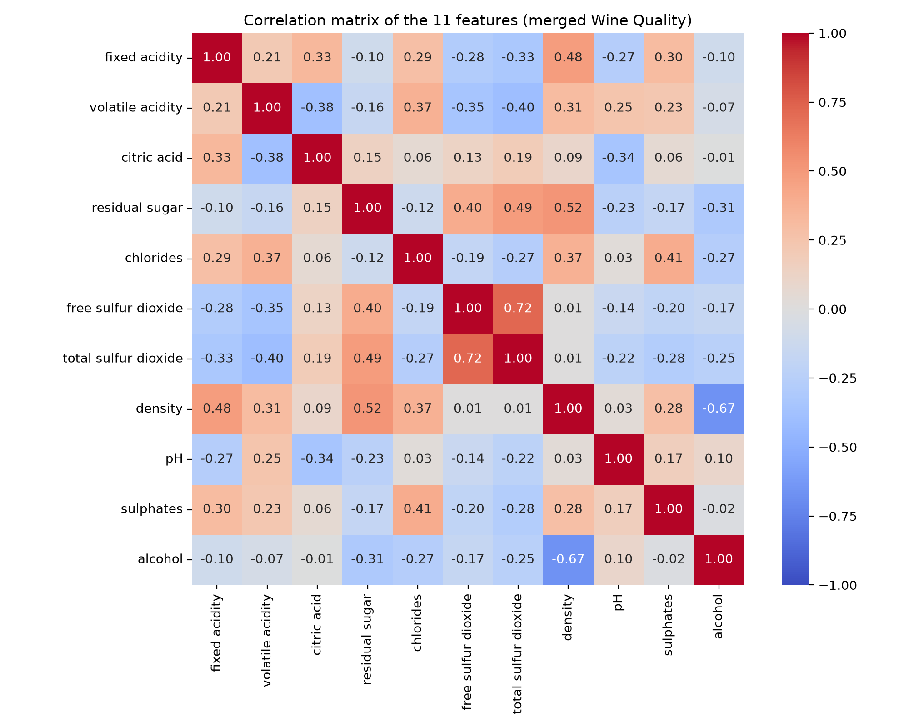
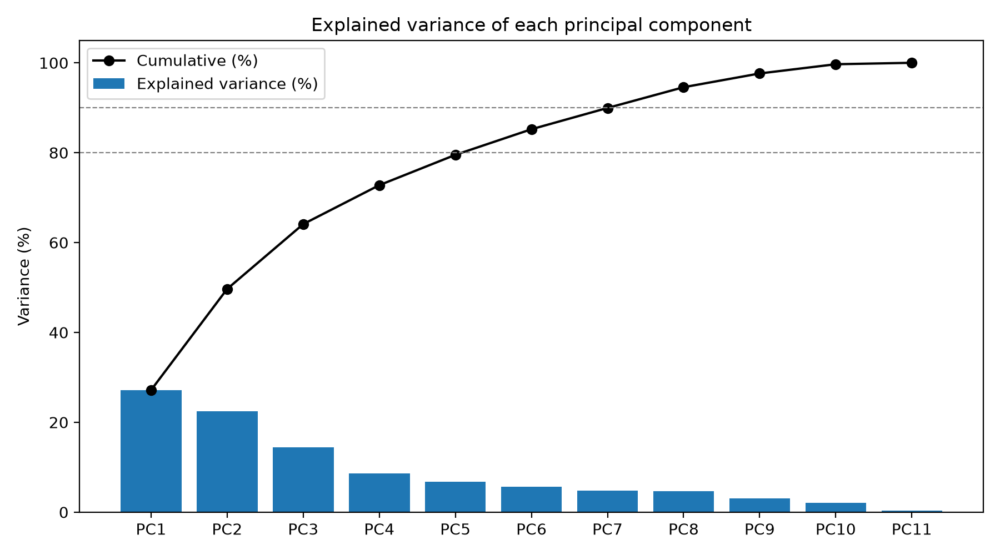
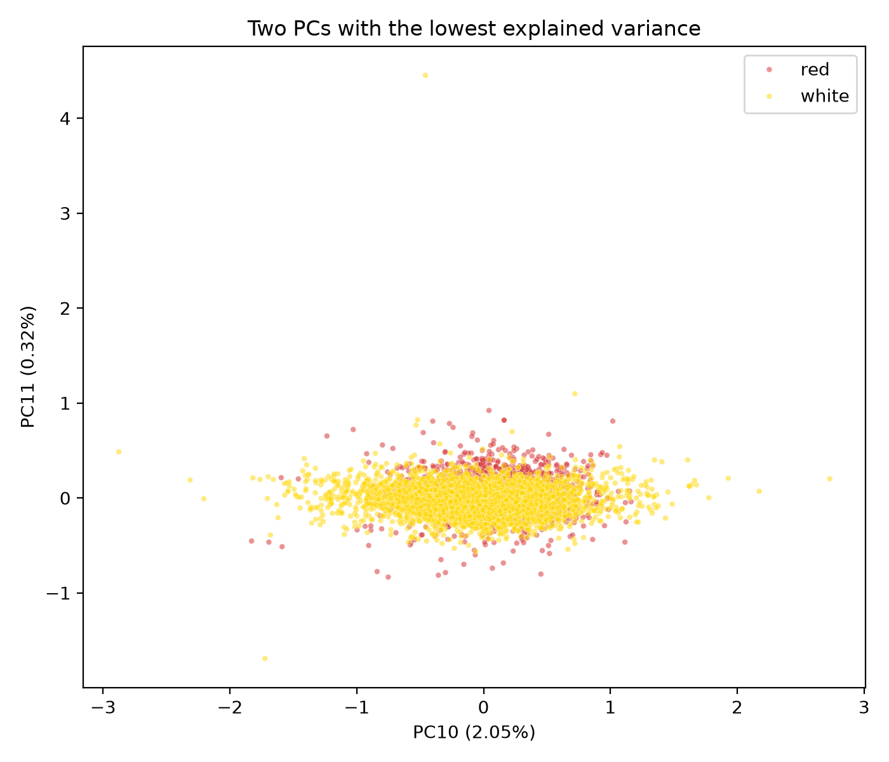
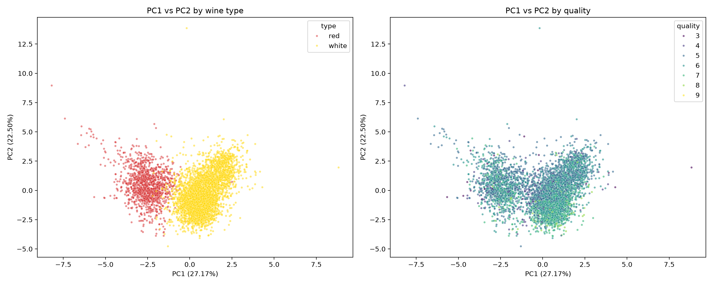

### 2. Dataset 2: Wine Quality

### 2.1. Overview and Description
- Data source: [Wine Quality - UCI ID 186](https://archive.ics.uci.edu/dataset/186/wine+quality), [Cortez et al. (2009)](https://doi.org/10.1016/j.dss.2009.05.016)
- The dataset is made of two subsets, red wine and white wine, each in its own file. The red wine set contains 1599 instances (rows), and there are 4898 for the white wine set, before cleaning. Both files have 12 columns, including 11 numerical attributes as input plus 1 categorical output, quality.

| Feature                                                                                                                                             | Description | Feature Type |
|-----------------------------------------------------------------------------------------------------------------------------------------------------|-------------|--------------|
| `fixed acidity`, `volatile acidity`, `citric acid`, `residual sugar`, `chlorides`, `free sulfur dioxide`, `total sulfur dioxide`, `density`, `pH`, `sulphates`, `alcohol` |             Physicochemical lab measurements (e.g. alcohol in % vol, pH)|              Quantitative, Numerical, Continuous|
| `quality`                                                                                                                                             |             Expert sensory score, integer from 0 (very bad) to 10 (very excellent); median of at least 3 evaluations|              Qualitative (ordinal), Categorical, Discrete|

The 11 input variables are measured quantities with units, so they are quantitative and numerical. Measured on a real-valued scale, so they can take any value in a range and are continuous.

`quality` is stored as an integer grades, so discrete. The grade is ordered, but the gap between grades is not a measured quantity. Therefore, it is qualitative and ordinal.

- In this dataset, `quality` is the label, so the data supports regression or (multi-class) classification, ordinal fits both.

### 2.2. Data cleaning
#### 2.2.1. Missing values, duplicates, incorrect values, inconsistencies
The dataset does not have any missing values, but it has many duplicates. The red wine set has 15.01% duplicate rows and about 19.13% of the white rows.

For the inconsistency check, rows with the same 11 features do not have different `quality`, so there are no conflicting labels. 

Thus, we can treat them as repeated records and drop them so they do not get double weight in the mean and covariance or pull principal components. A limitation is that, with no wine identifier in the dataset, we cannot be sure whether identical rows are repeated records or different wines.

We check the data with hard physical rules: all values ≥ 0, pH between 0 and 14, alcohol between 0 and 100 % vol, and free SO2 ≤ total SO2. No rows break these rules, so there are no incorrect values. Some values are extreme but still possible and not treated as errors.

#### 2.2.2. Outlier detection
Outliers are checked after removing duplicates so quartiles and counts are not distorted by repeated rows. 

We applied the IQR method to each file on the 11 features only (except `quality`):
`IQR = Q3 - Q1` where Q1 and Q3 are the 25th and 75th percentiles, to find the range of the middle 50% of the data.

To detect the outliers, we use 2 fences:
`lower = Q1 − 1.5×IQR` and `upper = Q3 + 1.5×IQR` (due to a convention from Tukey, 1977). Any value outside the fences is flagged as an outlier.

Here is the result table:
| Feature              | Red: flagged | Red: % | White: flagged | White: % |
|----------------------|--------------|--------|----------------|----------|
| fixed acidity        | 41           | 3.02   | 106            | 2.68     |
| volatile acidity     | 19           | 1.40   | 133            | 3.36     |
| citric acid          | 1            | 0.07   | 223            | 5.63     |
| residual sugar       | 126          | 9.27   | 16             | 0.40     |
| chlorides            | 87           | 6.40   | 178            | 4.49     |
| free sulfur dioxide  | 26           | 1.91   | 44             | 1.11     |
| total sulfur dioxide | 45           | 3.31   | 14             | 0.35     |
| density              | 35           | 2.58   | 6              | 0.15     |
| pH                   | 28           | 2.06   | 46             | 1.16     |
| sulphates            | 55           | 4.05   | 96             | 2.42     |
| alcohol              | 12           | 0.88   | 0              | 0.00     |

For normally distributed data, the fences are about ±2.7σ, flagging about 0.7% of points. Several feature percentages are much higher (e.g., 9.27% for red residual sugar) so they are not normal.

Some features have negative lower fences: red has them for citric acid, free SO2, and total SO2, and white has them for residual sugar and free SO2. Values can’t be below 0, so all outliers are on the high side, which indicating right skew.

Top outlier features of red and white wine are different, such as red residual sugar (9.27%) and chlorides (6.40%) versus white citric acid (5.63%) and chlorides (4.49%); this supports the use of IQR per file.

There are many rows affected: 25.02% rows have at least one outlier in red wine and 17.82% rows in white wine set. Removing all of them would lose many real wines; they are still plausible values. Consequently, these outliers are kept.

A limitation of keeping them is that they increase the variance, affecting the covariance, correlation and also the directions of principal components in PCA.

Table X summarizes the cleaning of both files: only duplicate rows were removed, and the outliers were kept.
|                                    | Red before | Red after   | White before | White after |
|----------------------------------------|------------|-------------|--------------|-------------|
| Total records                          | 1599       | 1359        | 4898         | 3961        |
| Records with missing values            | 0          | 0           | 0            | 0           |
| Duplicate records                      | 240        | 0           | 937          | 0           |
| Records with detected inconsistencies  | 0          | 0           | 0            | 0           |
| Records with incorrect values          | 0          | 0           | 0            | 0           |
| Records with at least one IQR outlier  | –          | 340 (kept)  | –            | 706 (kept)  |

### 2.3. Data integration and transformation
#### 2.3.1. Integration
Integration is beneficial; the two files have the same schema but are split by wine colour. Merging them gives one dataset for statistics and PCA. With the addition of an extra (nominal) feature type, we can check whether PCA separates red and white.

We use the row union method (concat, vertical stacking) to merge, with the new type column. The merged result is displayed in the table below:

|                                     | Result |
|-------------------------------------|-------:|
| Rows red (after cleaning)           |   1359 |
| Rows white (after cleaning)         |   3961 |
| Rows after integration              |   5320 |
| No rows lost or duplicated          |   True |
| Missing values after integration    |      0 |
| Identical rows found in both files  |      2 |

The result showed that the number of rows after integration equals the sum of the two files, and no missing values were added, so the merge did not lose or duplicate records. The two rows found in both files are kept, because they have a different type, so they are not duplicate records. However, combining two wine types still raises two challenges for the analysis.

*Challenge 1: two different populations.*
| Feature              |    Red |   White |
|----------------------|-------:|--------:|
| fixed acidity        |  8.311 |   6.839 |
| volatile acidity     |  0.529 |   0.281 |
| citric acid          |  0.272 |   0.334 |
| residual sugar       |  2.523 |   5.915 |
| chlorides            |  0.088 |   0.046 |
| free sulfur dioxide  | 15.893 |  34.889 |
| total sulfur dioxide | 46.826 | 137.194 |
| density              |  0.997 |   0.994 |
| pH                   |  3.310 |   3.195 |
| sulphates            |  0.659 |   0.490 |
| alcohol              | 10.432 |  10.589 |

Red and white wines are different products; their means differ strongly for several features. White wines have much higher free and total sulfur dioxide, residual sugar and citric acid. Red wines have higher volatile acidity, chlorides, sulphates and fixed acidity. Because of this, merged statistics mix two groups; a merged correlation may come partly from the difference. We handle this in two ways: compare correlations within each type (Section 2.4.3) and colour the PCA plot by type (Section 2.5.4).

Challenge 2: imbalance between the types
After integration, white wine accounts for 3961 rows out of a total of 5320 rows (74.45%), and red wine 1359 (25.55%). White wine is about three-quarters of the merged data; it dominates the mean, covariance and principal component directions. Since this lab only describes the data and trains no model, and undersampling would discard many real wines, we do not rebalance the data. The result may reflect almost white wine as a limitation.

#### 2.3.2. Transformation
We applied Z-score standardization, `z = (x − μ) / σ` (`ddof=0`) to 11 numerical features of the merged data.

| Feature              | Mean before | Std before | Mean after | Std after |
|----------------------|------------:|-----------:|-----------:|----------:|
| fixed acidity        |      7.2152 |     1.3195 |        0.0 |       1.0 |
| volatile acidity     |      0.3441 |     0.1682 |        0.0 |       1.0 |
| citric acid          |      0.3185 |     0.1471 |        0.0 |       1.0 |
| residual sugar       |      5.0485 |     4.4998 |        0.0 |       1.0 |
| chlorides            |      0.0567 |     0.0369 |        0.0 |       1.0 |
| free sulfur dioxide  |     30.0367 |    17.8034 |        0.0 |       1.0 |
| total sulfur dioxide |    114.1090 |    56.7689 |        0.0 |       1.0 |
| density              |      0.9945 |     0.0030 |        0.0 |       1.0 |
| pH                   |      3.2247 |     0.1604 |        0.0 |       1.0 |
| sulphates            |      0.5334 |     0.1497 |        0.0 |       1.0 |
| alcohol              |     10.5492 |     1.1858 |        0.0 |       1.0 |

Our features have very different scales (std of density is only 0.0030, while total sulfur dioxide is 56.7689, about 19,000 times larger). PCA looks for the directions of maximum variance, so without scaling, the SO2 features would dominate only because of their units. Z-score was applied to rescale features so that their means and standard deviations are approximately 0 and 1, respectively. We standardize the merged data, not each type separately, because separate scaling would give both types mean 0 and remove the red/white difference that PCA should show.

However, standardization still affected by outliers because the mean and standard deviation are computed from all values, including the extreme ones.

The two categorical features are not scaled. quality is an ordinal label, so its grades should stay as grades. Feature type is encoded as 0 for red, and 1 for white wine. It is not part of the PCA input and it is used only to colour the plots.

### 2.4. Statistics and correlation
#### 2.4.1. Mean, variance, covariance
#### Mean and variance
The mean and variance of the 11 physicochemical features were computed on original merged data.

| Feature              | Mean     | Variance   |
|----------------------|---------:|-----------:|
| fixed acidity        | 7.2152   | 1.7415e+00 |
| volatile acidity     | 0.3441   | 2.8307e-02 |
| citric acid          | 0.3185   | 2.1655e-02 |
| residual sugar       | 5.0485   | 2.0252e+01 |
| chlorides            | 0.0567   | 1.3589e-03 |
| free sulfur dioxide  | 30.0367  | 3.1702e+02 |
| total sulfur dioxide | 114.1090 | 3.2233e+03 |
| density              | 0.9945   | 8.7942e-06 |
| pH                   | 3.2247   | 2.5721e-02 |
| sulphates            | 0.5334   | 2.2423e-02 |
| alcohol              | 10.5492  | 1.4064e+00 |

The variances differ by many orders of magnitude between features. The largest, total sulfur dioxide (≈ 3.2 × 10³), is about 3.7 × 10⁸ times the smallest, density (≈ 8.8 × 10⁻⁶), e.g. about eight orders of magnitude. Because PCA maximizes variance, running it on the raw data would make total sulfur dioxide dominate the first component only because of its units. This is why the features are standardized
before PCA.

#### Covariance and correlation
The covariance matrix has the same problem. The covariance of two features is measured in the product of their units. Therefore, the largest covariances are among the sulfur dioxide and residual sugar features, mostly because of their scale. Covariances therefore cannot be compared across pairs of features. To compare the strength of relationships we use the Pearson correlation, which rescales the covariance by the standard deviations:
`cor(x, y) = cov(x, y) / (σx σy)`
The correlation has no unit and always lies between −1 and +1, so all pairs can be compared on the same scale.

#### 2.4.2. Categorical statistics
Mean and variance are not meaningful for categorical features, so we describe them with frequencies and percentages. quality is ordinal, so we also report its mode and median. type is nominal, so only its frequency and mode are meaningful.

The distribution of quality is strongly imbalanced: grades 5 and 6 together cover 76.6% of the wines, while the extreme grades are rare. Grade 9 appears in only 5 wines, all of them white. Label quality classifier would be biased toward the middle grades and would have very few examples of the extreme grades.

| Quality | Red (%) | White (%) |
|--------:|--------:|----------:|
| 3       | 0.74    | 0.50      |
| 4       | 3.90    | 3.86      |
| 5       | 42.46   | 29.66     |
| 6       | 39.37   | 45.14     |
| 7       | 12.29   | 17.39     |
| 8       | 1.25    | 3.31      |
| 9       | 0.00    | 0.13      |

Because the two types have very different sizes, we compare percentages within each type, not raw counts. White wines have a larger share of the higher grades (7–9: 20.83% vs 13.54% for red), while red wines have a larger share of grade 5 (42.46% vs 29.66%). So the distribution of quality depends on type: the two categorical features are related.

#### 2.4.3. Correlation analysis

Pearson correlation measures only linear relationships: a
value close to 0 means there is no linear relation, but a non-linear pattern
may still exist.

We found that the strongest correlation pair is free sulfur dioxide – total sulfur dioxide with r = 0.72. This moderate positive linear relationship is expected, because free SO₂ is part of total SO₂. The second one is density – alcohol (r = -0.67): wines with more alcohol have a lower density.

| Data   | Feature pair                         | r       |
|--------|--------------------------------------|--------:|
| Merged | free sulfur dioxide – total sulfur dioxide | 0.7205  |
|        | density – alcohol                    | −0.6678 |
|        | residual sugar – density             | 0.5209  |
| Red    | fixed acidity – pH                   | −0.6867 |
|        | fixed acidity – density              | 0.6702  |
|        | fixed acidity – citric acid          | 0.6674  |
| White  | residual sugar – density             | 0.8205  |
|        | density – alcohol                    | −0.7602 |
|        | free sulfur dioxide – total sulfur dioxide | 0.6194  |

The strongest merged pair is weaker inside white (r = 0.6194) and is not among the three strongest pairs in red. So part of the merged correlation comes from the difference between the two types: white wines are higher in both SO₂ features.

Each type also has its own strongest pair. In red wine it is fixed acidity – pH (r = −0.6867): more acid gives a lower pH, as expected chemically. In white wine it is residual sugar – density (r = 0.8205): sugar makes the wine denser. Therefore, correlations computed on the merged data do not describe each wine type well, and both types should be considered when interpreting them.

### 2.5. Principal Component Analysis
#### 2.5.1. Preprocessing and computation

PCA input shape: (5320, 11). We applied PCA to the 11 standardized physicochemical features. `quality` and `type` were left out, so PCA does not use any label. 

The covariance matrix has shape (11, 11) and was computed from the standardized data. We also ran an eigen decomposition (`np.linalg.eigh`), then sorted the components by eigenvalue. Each eigenvector is a PC direction, and its eigenvalue is the variance along that direction. The covariance matrix of the PC scores is diagonal, so the PCs are uncorrelated.

#### 2.5.2. Explained variance, highest vs lowest

| PC   | Eigenvalue | Explained variance (%) | Cumulative variance (%) |
|------|-----------:|-----------------------:|------------------------:|
| PC1  | 2.9889 | 27.1671 | 27.1671 |
| PC2  | 2.4757 | 22.5024 | 49.6695 |
| PC3  | 1.5876 | 14.4298 | 64.0993 |
| PC4  | 0.9536 |  8.6673 | 72.7666 |
| PC5  | 0.7424 |  6.7476 | 79.5142 |
| PC6  | 0.6272 |  5.7003 | 85.2145 |
| PC7  | 0.5211 |  4.7367 | 89.9513 |
| PC8  | 0.5077 |  4.6145 | 94.5658 |
| PC9  | 0.3368 |  3.0611 | 97.6269 |
| PC10 | 0.2260 |  2.0542 | 99.6811 |
| PC11 | 0.0351 |  0.3189 | 100.0000 |

PC1 explains 27.1671% and PC2 explains 22.5024%. Only the first three PCs have an eigenvalue above 1, so each of them carries more variance than one original standardized feature. The scree plot decreases smoothly and has no sharp elbow, so it does not give a clear number of components.

| k | k highest PCs (%) | k lowest PCs (%) |
|---|------------------:|-----------------:|
| 1 | 27.17 |  0.32 |
| 2 | 49.67 |  2.37 |
| 3 | 64.10 |  5.43 |
| 5 | 79.51 | 14.79 |

The highest PCs keep most of the information: the first 5 PCs keep 79.51%, while the last 5 PCs keep only 14.79%. PC11 explains only 0.32% (eigenvalue 0.04). This means that in this direction the features are almost linearly dependent, so this PC contains almost only redundant information.

In this plot, the points form one small cloud around 0, and red and white wines are completely mixed. The lowest PCs show no structure. Dropping them loses very little information, but keeping only them would lose almost everything.

#### 2.5.3. Number of components

| Number of PCs (k) | Retained variance (%) | Discarded variance (%) | Dimensions removed |
|---:|------:|------:|---:|
| 1  | 27.17 | 72.83 | 10 |
| 2  | 49.67 | 50.33 | 9 |
| 3  | 64.10 | 35.90 | 8 |
| 4  | 72.77 | 27.23 | 7 |
| 5  | 79.51 | 20.49 | 6 |
| 6  | 85.21 | 14.79 | 5 |
| 7  | 89.95 | 10.05 | 4 |
| 8  | 94.57 |  5.43 | 3 |
| 9  | 97.63 |  2.37 | 2 |
| 10 | 99.68 |  0.32 | 1 |
| 11 | 100.00 | 0.00 | 0 |

The smallest number of PCs needed is 6 to keep at least 80% of the variance, 8 to keep 90%, and 9 to keep 95%. Note that 7 PCs keep 89.95%, just below 90%.

The choice is a trade-off. More PCs keep more information but remove fewer dimensions. With 6 PCs we keep 85.21% of the variance and remove 5 of the 11 dimensions. With 8 PCs we keep 94.57% but remove only 3. Because the scree plot has no clear elbow, the dimensionality reduction for this dataset is moderate: the 11 features cannot be summarized by only 2 or 3 PCs without losing much information.

#### 2.5.4. 2D visualization

PC1 is the red/white axis. Its positive loadings (total SO2 0.48, free SO2 0.43, residual sugar 0.30) are features higher in white wine; its negative loadings (volatile acidity −0.39, chlorides −0.32, sulphates −0.32) are higher in red. In the plot, red wines are on the negative side and white wines on the positive side, with little overlap.

PC2 is mainly density (0.57) vs alcohol (−0.47), matching their strong correlation (r = −0.67).

Quality grades overlap strongly. From grade 5 to 9, mean PC2 decreases (0.65 to −1.53), so better wines tend to have more alcohol, but the spread within each grade is much larger. PCA is unsupervised: it finds the largest variance (here, wine type), not the quality difference. A few isolated points are the outliers we kept. The 2D view keeps only 49.67% of the variance.

#### 2.5.5. Original vs PCA, pros and cons
Table X. Original data vs PCA-transformed data

| | Original (standardized) | PCA |
|---|---|---|
| Number of wines | 5,320 | 5,320 |
| Number of features | 11 | k PCs (6 for 80%, 8 for 90%) |
| Features | physicochemical measurements | linear combinations of the 11 features |
| Correlation between features | yes (e.g. free–total SO2, r = 0.72) | none (PCs are uncorrelated) |

Table X. Pros and cons of PCA for this dataset

| Aspect | Pros | Cons |
|---|---|---|
| Information preservation | 8 PCs keep 94.57% of the variance with 3 fewer dimensions; correlated, redundant information is removed | Some information is always lost; 2 PCs keep only 49.67% |
| Interpretability | PC1 has a clear meaning (red vs white), PC2 is mainly density vs alcohol | Each PC mixes all 11 features, so it is harder to explain than an original feature such as alcohol |
| Visualization | 11 dimensions become a 2D plot; red and white are clearly separated | Quality grades are not separated in 2D; outliers can distort the view |

In summary, PCA works well to show the main structure of the data, which is the difference between red and white wines. But it does not reduce the data very strongly (6–8 PCs are needed), and the first PCs do not show the difference in quality.